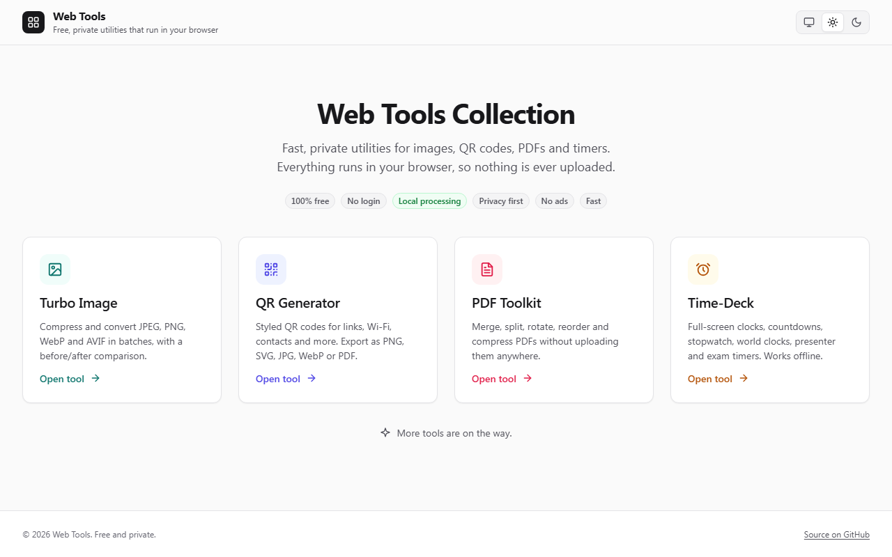

# Web Tools Collection – Free, Private Browser Tools

Free online tools that run entirely in your browser: **compress and convert images, generate QR codes, merge, split and compress PDFs, and run full-screen clocks, countdowns and timers**. No sign-up, no ads, and your files are never uploaded.

**[Launch Web Tools Collection](https://chrisjdj.github.io/web-tools/)**

---

## 🚀 Features

- **100% Free Forever**: No hidden costs or premium tiers.
- **No Login Required**: Start using the tools instantly.
- **Local Processing (No Server)**: All processing is done locally in your browser. No data is sent to external servers.
- **Privacy First**: Your data remains yours. We don't track or store your usage.
- **Zero Ads**: A clean, distraction-free environment.
- **Lightning Fast**: Built for speed and efficiency.
- **Light & Dark Theme**: Follows your system setting by default. Pick System, Light or Dark in the header; the choice is shared by every tool in the collection.
- **Works Everywhere**: Responsive, accessible layouts (WCAG 2.2 AA) from small phones to wide desktops.

---

## 🧰 Tools Included

### [Turbo Image](https://chrisjdj.github.io/Turbo-Image/)
Lightning-fast image optimization and processing workflow. Compress, convert, and prepare assets instantly.

### [QR Generator](https://chrisjdj.github.io/QR-Code-Gen/)
Generate precise, customizable QR codes in milliseconds. Tailored for URLs, text, and contact information.

### [PDF Toolkit](https://chrisjdj.github.io/PDF-Toolkit/)
Comprehensive PDF management. Merge multiple files, split pages, and rotate documents with instant client-side processing.

### [Time-Deck](https://chrisjdj.github.io/Time-Deck/)
Full-screen clocks and timers for any screen, TV or projector: countdowns, stopwatch with laps, world clocks, meeting planner, presenter and exam timers, pomodoro and alarms. 12h (AM/PM) or 24h time, works offline. [Source and docs](https://github.com/chrisjdj/Time-Deck).

<picture>
  <source media="(prefers-color-scheme: dark)" srcset="docs/screenshots/dark-desktop.png" />
  
</picture>

Turbo Image, QR Generator, PDF Toolkit and Time-Deck each have their own repository and are deployed to their own GitHub Pages site. The `Turbo-Image/`, `QR-Code-Gen/`, `PDF-Toolkit/` and `Time-Deck/` folders in this repo hold only a redirect page, so old `/web-tools/<tool>/` links (including query strings and hashes) land on the standalone sites.

---

## 🔎 Common tasks

- **Compress a photo for the web:** [Turbo Image](https://chrisjdj.github.io/Turbo-Image/) → WebP or AVIF.
- **Make a Wi-Fi or contact QR code:** [QR Generator](https://chrisjdj.github.io/QR-Code-Gen/).
- **Merge two PDFs or extract pages:** [PDF Toolkit](https://chrisjdj.github.io/PDF-Toolkit/).
- **Run a countdown on a projector, time a talk or an exam, or compare world clocks:** [Time-Deck](https://chrisjdj.github.io/Time-Deck/).

---

## 🛠️ Editing the hub

The page is static (`index.html`, `styles.css`, `theme.js`) with no build step. Styles are written in SCSS under `styles/` using the design system shared with the tools (tokens, theme, base, components, shell; see the `DESIGN.md` in any tool repo). After changing a `.scss` file, recompile:

```bash
npx sass --no-source-map --style=compressed styles/main.scss styles.css
```

The theme preference (`theme-preference` in localStorage: `system`, `light` or `dark`) is applied before first paint by the inline script in `index.html`; `theme.js` wires up the switch.

### Search and sharing

- `index.html` carries the title, description, Open Graph/Twitter tags and JSON-LD structured data (a `WebSite` plus an `ItemList` of the tools). Keep the tool list in the JSON-LD in step with the cards.
- `sitemap.xml` lists the pages served from this repo (the hub). Update `lastmod` when they change, and submit it in Google Search Console: a project site under `github.io/web-tools/` cannot publish its own `robots.txt`, so search engines will not find the sitemap on their own.
- `og-image.png` (1200×630) is the preview image shown when the hub link is shared.

---

## 💡 Suggest the Next App!

I'm always looking for new ideas for incredible tools to add to this collection! If you have a suggestion for a utility you'd love to see built next, please head over to the **[Discussions Tab](https://github.com/chrisjdj/web-tools/discussions)** and share your ideas! We'd love to hear what would make your workflow easier.
